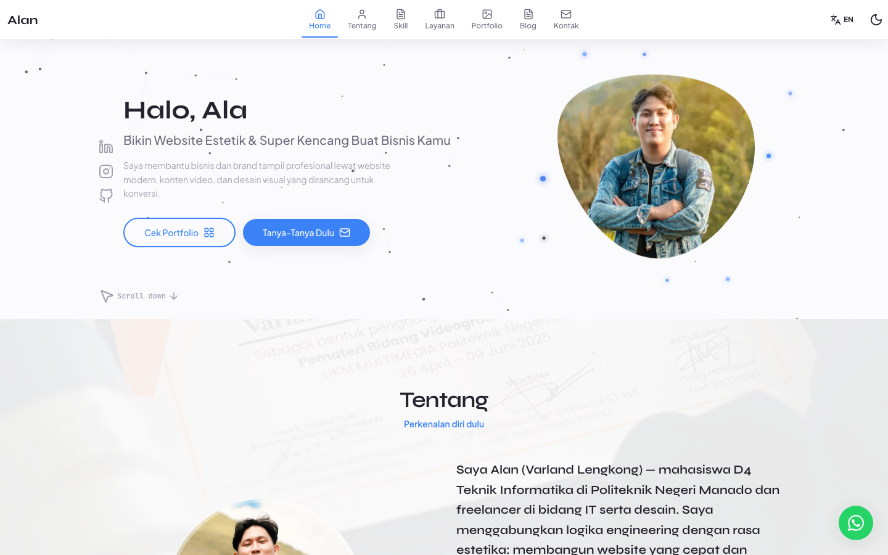
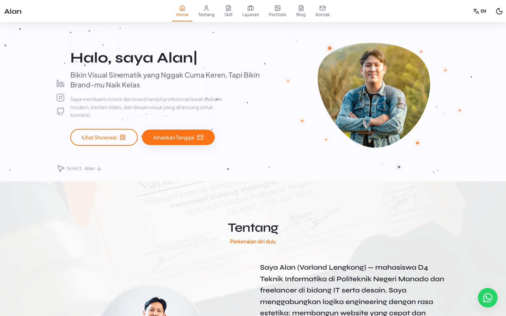

# 💼 Portfolio — Alan (Varland Lengkong)

Website portfolio pribadi dua sisi: **Developer / Programmer** ⚙️ dan **Creative / Videographer** 🎬 — lengkap dengan toggle mode, dark mode, bahasa Indonesia/Inggris, feed Instagram, blog, dan **dashboard admin (Decap CMS)**.

> 🚀 **Live demo:** [lansilvester.github.io](https://lansilvester.github.io/)

## 🏷️ Badges


## ✨ Preview

| ⚙️ Developer mode | 🎬 Creative mode |
| :---: | :---: |
|  |  |

## 🚀 Fitur

- 🔄 **Dua mode personal branding** (Developer & Creative) — gaya visual & konten berbeda, perpindahan instan dengan animasi
- 🌗 **Dark / light theme**
- 🌐 **Bahasa Indonesia / English**
- 🗂️ **Portfolio grid** dengan filter kategori + modal detail & lightbox (navigasi keyboard)
- 📸 **Feed Instagram** (marquee 2 baris) sebagai portfolio mode Creative — diperbarui otomatis setiap 3 jam
- 📝 **Blog** berbasis markdown dengan halaman detail
- 💬 **Tombol WhatsApp mengambang**
- ✉️ **Form kontak** dengan validasi + honeypot → email (Web3Forms) atau fallback WhatsApp
- 💰 **Paket harga layanan** (freelance)
- ⚙️ **Dashboard admin** di `/admin/` (Decap CMS): edit teks, kelola skill/layanan/portfolio, upload foto, atur urutan & visibilitas section, tulis blog, kelola SEO — semua perubahan otomatis di-commit ke git
- 🔍 **SEO**: meta Open Graph yang bisa diedit dari dashboard, JSON-LD `Person`, `robots.txt`, `sitemap.xml`, `404.html`
- 📊 **Analytics GoatCounter**
- 🧪 **Unit test (Vitest + Testing Library)** sebagai gerbang CI bersama lint
- 🚢 **Deploy otomatis** ke GitHub Pages via GitHub Actions

## 🛠️ Stack

| Layer | Teknologi |
| --- | --- |
| Frontend | React 19 · react-router 8 · lucide-react · react-type-animation |
| Styling | Tailwind CSS v4 · variabel CSS `--c-*` / `--p-*` |
| Build | Vite (code-splitting per section, `prebuild` fetch feed) |
| CMS | Decap CMS (`/admin/`) |
| Testing | Vitest · Testing Library · oxlint |
| CI/CD | GitHub Actions → lint → test → build → GitHub Pages |

## 📂 Arsitektur konten

Semua konten yang bisa diedit **disimpan sebagai data (JSON)**, bukan di dalam kode — sehingga bisa dikelola lewat dashboard:

| File | Isi | Diakses lewat |
| --- | --- | --- |
| `src/data/content.json` | Hero, about, kualifikasi, skill, layanan, portfolio, feed Instagram, harga, kontak, socials | `src/data/content.js` |
| `src/data/ui.json` | Label antarmuka (nav, tombol, judul section) | `t('nav.home')` |
| `src/data/layout.json` | Urutan & visibilitas section | `App.jsx` |
| `src/data/site.json` | SEO / Open Graph (di-replace saat build) | Plugin Vite |
| `src/blog/posts/*.md` | Artikel blog (frontmatter + markdown) | `src/utils/blog.js` |

Setiap teks bilingual memakai bentuk `{ "id": "...", "en": "..." }` atau path string. Komponen membaca lewat `t()` di `src/i18n.jsx`.

> 📚 Ingin memahami **kenapa** arsitekturnya begini (pola, pelajaran, checklist bug)? Baca **[LEARNING.md](./LEARNING.md)**.

## 🧭 Menjalankan di lokal

```bash
npm install
npm run dev      # development (http://localhost:5173)
npm run build    # build produksi ke dist/ (otomatis refresh feed Medium & Instagram)
npm run preview  # pratinjau hasil build
npm run lint     # oxlint
npm test         # vitest
npm run fetch:instagram  # refresh feed Instagram manual
npm run fetch:medium     # refresh artikel Medium manual
```

## 🎛️ Dashboard admin (Decap CMS)

Buka **`https://lansilvester.github.io/admin/`** → login dengan akun GitHub yang punya akses push ke repo. Setiap perubahan otomatis di-commit → workflow build & deploy ulang → situs ter-update dalam ±1–2 menit. Semua edit punya riwayat git, jadi bisa di-undo.

Yang bisa dikelola:

- **Teks & Label** — semua teks ID/EN (hero, about, judul section, tombol, placeholder, footer)
- **Konten Situs** — menu, socials, profil, kualifikasi, skill, layanan, karya portfolio (+ upload gambar), info kontak, paket harga, konfigurasi feed Instagram, form kontak
- **SEO** — title, description, Open Graph (menu *Settings*)
- **Blog** — tulis/edit artikel markdown; ikut di-build saat deploy
- **Urutan & Tampilan** — urutan & visibilitas section

### Form kontak → email (Web3Forms)

Secara bawaan, submit form membuka **WhatsApp**. Untuk kirim ke **email**, isi `CONTACT_FORM.accessKey` (gratis) dari [web3forms.com](https://web3forms.com/) lewat dashboard → **Konten Situs → Form Kontak**. Setelah diisi, submit mengirim JSON ke endpoint Web3Forms.

### Setup login admin (sekali, via Cloudflare Workers)

1. **Buat GitHub OAuth App** — https://github.com/settings/applications/new
   - *Homepage URL*: `https://<proxy-domain>.workers.dev`
   - *Authorization callback URL*: `https://<proxy-domain>.workers.dev/callback`
   - Simpan *Client ID* dan generate *Client Secret*.
2. **Deploy proxy** (template resmi `sterlingwes/decap-proxy`):
   ```bash
   git clone https://github.com/sterlingwes/decap-proxy && cd decap-proxy
   cp wrangler.toml.sample wrangler.toml   # ubah `name` sesuai keinginan
   npx wrangler login
   npx wrangler secret put GITHUB_OAUTH_ID     # isi Client ID
   npx wrangler secret put GITHUB_OAUTH_SECRET # isi Client Secret
   npx wrangler deploy
   ```
   Buka URL worker — harus muncul tulisan "Hello 👋".
3. **Isi `base_url`** di `public/admin/config.yml` dengan `https://<proxy-domain>.workers.dev`, lalu commit & push.

> Repo ini publik, jadi tidak perlu variabel `GITHUB_REPO_PRIVATE`.

### Tes offline (opsional)

1. Ubah `local_backend: false` → `true` di `public/admin/config.yml`.
2. Jalankan `npx decap-server` (terpisah) lalu `npm run dev` dan buka `http://localhost:5173/admin/`.
3. Kembalikan `local_backend: false` sebelum deploy.

## 🗂️ Mengubah konten langsung di kode

- **Foto/karya asli** → taruh di `public/images/` (atau `public/images/uploads/`), lalu ubah path di `src/data/content.json`.
- **Link proyek** → nilai `demo` (URL live) dan `github` (URL repo) di `src/data/content.json` (awalnya `#`).
- **Feed Instagram** → refresh manual dengan `npm run fetch:instagram` (atau otomatis saat `npm run build`), lalu commit hasilnya.

## 🚢 Deploy

Push ke branch `main` — workflow `.github/workflows/deploy.yml` otomatis menjalankan **lint + unit test**, build, lalu deploy ke GitHub Pages. Deploy dibatalkan bila lint/test gagal.

Feed Instagram di-refresh otomatis oleh `.github/workflows/update-instagram.yml` (cron tiap 3 jam) — jika ada perubahan, ia commit + push serta men-trigger deploy ulang.

## 🔗 Konfigurasi lain

- **Analytics**: buat akun di [goatcounter.com](https://www.goatcounter.com/) dengan subdomain `lansilvester`, sesuaikan `data-goatcounter` di `index.html`.
- **Foto profil** → `public/images/profile.svg`.
- **CV** → `public/CV/`.
